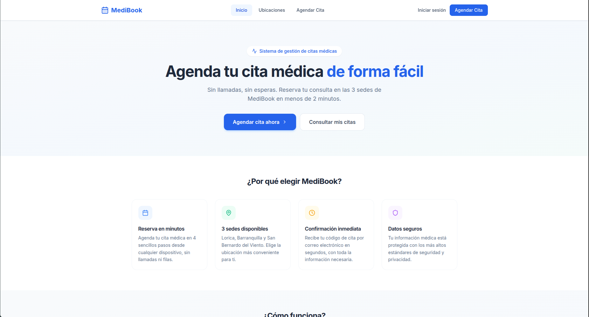
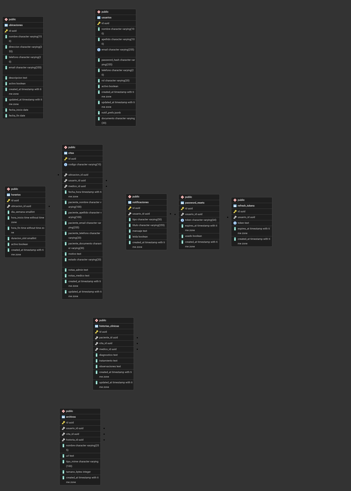
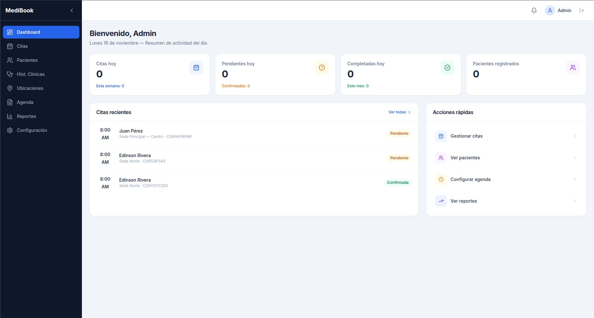
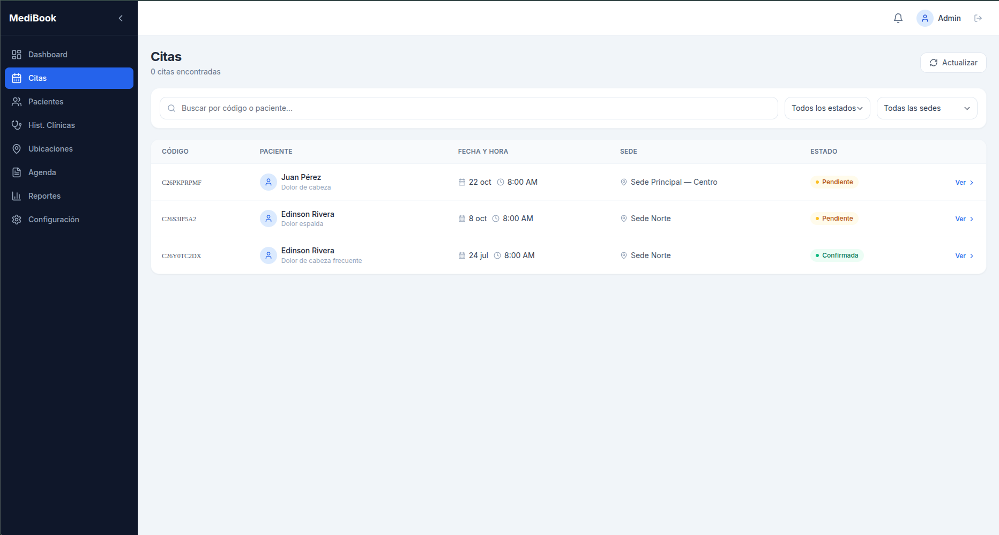

# MediBook · Citas médicas en tres sedes

**Demo:** [enlace](https://gestion-citas-medicas-hazel.vercel.app/)

> El código fuente es privado porque está pensado para manejar datos de pacientes. Con gusto lo muestro en una entrevista.

## El problema

Un médico que atiende en tres sedes necesitaba una sola agenda para él y sus pacientes, cumpliendo la ley colombiana de protección de datos.

## La solución

Un sistema con portal para pacientes, panel para la asistente y panel de administración, que maneja la agenda de las tres sedes.

## Qué hice

Actué como analista y desarrollador: organicé el trabajo en 28 tickets y 4 fases, diseñé la base de datos y construí el backend y el frontend.

## Stack

| Capa | Tecnología |
| --- | --- |
| Frontend | React, Vite |
| Backend | Node.js, Express, API REST |
| Base de datos | PostgreSQL |
| Seguridad | JWT (access y refresh tokens), control de acceso por roles |

## Decisiones técnicas

- **Base de datos:** esquema relacional de 9 tablas con ENUMs, triggers e índices.
- **Seguridad:** JWT con access y refresh tokens, y tres roles: admin, asistente y paciente.
- **Normativa:** códigos de diagnóstico CIE-10 y cumplimiento de la Ley de Habeas Data.

## Lo que falló y cómo lo resolví

**Citas duplicadas.** Dos pacientes podían reservar la misma sede a la misma hora. Lo resolví en dos capas: el frontend solo muestra los horarios libres, y el backend vuelve a comprobarlo antes de guardar y responde con un `409 Conflict` si el horario ya está ocupado.

## Modelo de datos

## Capturas

| Portal del paciente | Panel de la asistente |
| --- | --- |
|  |  |

---

Hecho por **Edinson Rivera** · [Portafolio](https://portafolio-desarrollo2026.vercel.app/) · [LinkedIn](https://www.linkedin.com/in/edinson-rivera-dev)# medibook-case-study
